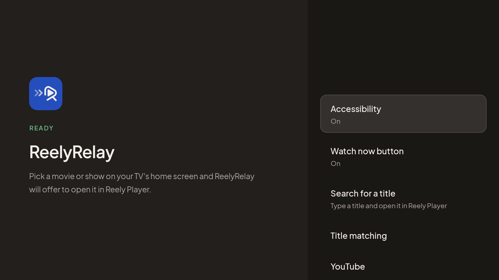
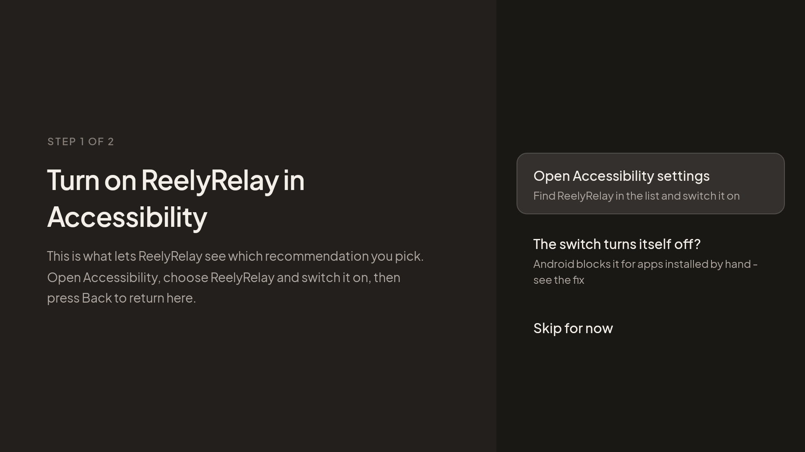

# ReelyRelay

[](../../releases)
[](LICENSE)

Your TV's home screen recommends a movie, you select it, and it opens in whatever app the recommendation came from. ReelyRelay catches that selection and opens the title in **[Reely Player](https://reelyplayer.app)** instead, after one press to confirm so a stray click never sends you anywhere by accident.



Free, no account. It hosts and provides no content: it reads the title of the recommendation you selected, looks it up on TMDB, and hands you to Reely Player.

🌐 [Project site](https://romaixn.github.io/ReelyRelay/) - the same guide, easier to read on a phone.

ReelyRelay is a fork of **[TVRelay](https://github.com/hmartinez94/TVRelay)** by Hector Martinez, narrowed to a single player. If it is useful to you, the original project is the one to thank.

## Contents

- [How it works](#how-it-works)
- [Requirements](#requirements)
- [Installation](#installation)
- [Setup](#setup)
  - [Accessibility won't stay on](#accessibility-wont-stay-on)
  - [Fire TV](#fire-tv)
- [Settings](#settings)
- [Limitations](#limitations)
- [Troubleshooting](#troubleshooting)
- [Building from source](#building-from-source)
- [Publishing a release](#publishing-a-release)
- [Legal notice](#legal-notice)
- [Credits](#credits)

## How it works

1. **You pick a recommendation** on the home screen.
2. **ReelyRelay identifies it.** Android's Accessibility API lets an app observe what's on screen; ReelyRelay uses it narrowly, watching only for clicks on the Google TV launcher. When a click carries a movie or show title, it looks that title up on [TMDB](https://www.themoviedb.org/).
3. **You confirm, Reely Player opens** on that title's page, through its `reely://detail/{movie|series}/{tmdbId}` link.


Every other click - app icons, menus, anything that isn't a recommendation - is left alone, and nothing is read, stored, or sent anywhere beyond that one lookup.

## Requirements

- A device with the **Google TV** launcher (Chromecast with Google TV, or Google TV editions from Sony, TCL, Hisense and others), or a **Fire TV** using [Fire TV mode](#fire-tv).
- **Reely Player** installed on the same device.

## Installation

ReelyRelay isn't on an app store - install the APK from the [Releases](../../releases) page.

### From your phone, with Send Files to TV

1. On the TV, install **[Send Files to TV](https://play.google.com/store/apps/details?id=com.jstenpal.sendfilestotv)** and open it.
2. On your phone, download the APK from [Releases](../../releases) and send it to the TV with the same app.
3. Open the file on the TV and allow the install when Android asks.

### With Downloader

Install the **Downloader** app (by AFTVnews) on the TV and enter:

```
github.com/Romaixn/ReelyRelay/releases/latest/download/ReelyRelay.apk
```

### Over ADB

This also turns Accessibility on, so you can skip that step in the app.

```
adb connect <tv-ip>:5555
adb install ReelyRelay.apk
adb shell appops set com.reely.relay ACCESS_RESTRICTED_SETTINGS allow
adb shell settings put secure enabled_accessibility_services com.reely.relay/com.reely.relay.RelayAccessibilityService
adb shell settings put secure accessibility_enabled 1
```

The fourth line **replaces** the whole list of enabled accessibility services. If you already use another one (like TalkBack), keep it in the list and separate the two with a colon (`:`).

## Setup

Open **ReelyRelay** on the TV. The first run walks you through two steps, and moves on by itself as soon as each one is granted:



1. **Accessibility** - what lets ReelyRelay see which recommendation you pick. Without it, nothing happens.
2. **The Watch now button** - optional, recommended. It needs the "Display over other apps" permission. Without it, a recognized title opens in Reely Player straight away, with no confirmation.

After that, the app's home screen always says whether it is working, and if not, the one thing that is missing.

### Accessibility won't stay on

On Android 13 and later, the system blocks apps that weren't installed from a store from turning Accessibility on: you flip the switch and it turns itself straight back off. That is a safeguard, not a bug. Two ways past it:

- **Allow restricted setting.** In ReelyRelay: **Accessibility**, then **The switch turns itself off?**, then **Open app info**. Look for "Allow restricted setting", often behind a three-dot menu. Many TVs don't have it.
- **One ADB command**, then switch Accessibility on again:

  ```
  adb shell appops set com.reely.relay ACCESS_RESTRICTED_SETTINGS allow
  ```

  No computer? **[atvTools](https://play.google.com/store/apps/details?id=dev.vodik7.atvtools)** runs the same line from a phone - type it without the leading `adb shell`.

Updating ReelyRelay from inside the app puts the block back; run the command again afterwards, or update over ADB to avoid it.

On some devices (especially TV boxes with aggressive battery managers), you may also need to exclude ReelyRelay from the manufacturer's "optimizer" or RAM cleaner, or the system kills the service after a few seconds.

### Fire TV

Fire TV's home screen doesn't tell apps which recommendation you picked, so on a Fire TV ReelyRelay uses **Fire TV mode** instead: it notices when you open a recommendation and reads its title off the screen with on-device text recognition. It needs two permissions:

1. **Usage access**, to notice that you opened a recommendation. Many Fire TV Stick 4K / 4K Max devices on Fire OS 8 have no Usage access screen at all; grant it over ADB instead:

   ```
   adb shell appops set com.reely.relay GET_USAGE_STATS allow
   ```

2. **Screen recording**, to read the title. Android shows its recording indicator while Fire TV mode is on; that is a system requirement, not something ReelyRelay adds.

Worth knowing:

- Screen-recording permission is cleared by a restart, so **turn Fire TV mode on again after restarting** the device.
- It covers the home screen, mainly Amazon's own recommendation rows. A card that jumps straight into another app isn't caught.

## Settings

| | |
| --- | --- |
| **Watch now button** | Whether the button returns after you dismiss it, how long it waits (0.5-15 s, default 4), and "Hold Select to confirm". |
| **Search for a title** | Type a title yourself; everything after that works like an automatic match. |
| **Title matching** | "Ask which year to open" when several titles share a name; "Read titles from the screen" for cards that carry no title (see [Limitations](#limitations)). |
| **YouTube** | Optionally open YouTube video recommendations in SmartTube or TizenTube Cobalt. Off by default, and separate from Reely Player. |
| **More → TMDB key** | Lookups use a key bundled with the app. If it is ever rate-limited, enter your own free key ([themoviedb.org](https://www.themoviedb.org/), Settings → API). "Send key from phone…" shows a QR code so you can paste it on your phone instead of typing 32 characters with a remote. |

The interface is available in English, French and Spanish.

## Limitations

- **Some recommendation cards, and voice search results, don't expose a title.** That is a limit of what the launcher hands third-party apps. Use **Search for a title**, or turn on **Title matching → Read titles from the screen** (off by default): it reads the title off the screen on the device, and Android shows its recording indicator while it is on.
- **TMDB can match the wrong title** when a different movie or show has the same name. When two or more titles match exactly, ReelyRelay asks which one you meant.
- **Launcher languages.** Detection relies partly on phrases the launcher itself uses, which were captured for English (and, unverified, Spanish). Other languages - French included - rest on language-independent fallbacks, which cover most cards. To add real phrases for a language, see `app/src/main/res/values-fr/arrays.xml`.
- **YouTube redirect** opens a search for the video's title in the chosen app, not the exact video.

## Troubleshooting

**Accessibility is on, but picking a recommendation does nothing.** First check that Reely Player itself takes the link, with ReelyRelay out of the picture. This should land on Iron Man:

```
adb shell am start -a android.intent.action.VIEW -d "reely://detail/movie/1726" com.reely.reely
```

If it does, check that the click is being seen:

```
adb logcat -s ReelyRelay:D TitleHandler:D WatchNowOverlay:D PlayerLauncher:D
```

Every launcher click logs a `Click event:` line with exactly what the launcher exposed for that card.

## Building from source

Requires JDK 17+ and the Android SDK (platform 37). Get a free API key from [TMDB](https://www.themoviedb.org/settings/api) and put it in `local.properties` (not committed):

```
TMDB_API_KEY=your_key_here
```

Without it the build still works, but the app can't identify titles until a key is entered in **More → TMDB key**.

```
./gradlew assembleDebug        # app/build/outputs/apk/debug/app-debug.apk
./gradlew testDebugUnitTest    # opens every screen, in every language
```

The tests also draw every screen to `app/build/screenshots/` - the quickest way to see a UI change without a TV at hand. The images in this README come from there.

**With Nix:** `nix develop` gives you the JDK and Android SDK with nothing else to install.

**Signing a release:** add these to `local.properties` and run `./gradlew assembleRelease`. Without them the release APK is left unsigned.

```
RELEASE_STORE_FILE=keystore/release.jks
RELEASE_STORE_PASSWORD=...
RELEASE_KEY_ALIAS=...
RELEASE_KEY_PASSWORD=...
```

## Publishing a release

Releases are what the in-app updater and the Downloader link read, so they need an APK named `ReelyRelay.apk`.

One-time setup:

1. **GitHub Pages**: Settings → Pages → Deploy from a branch → `main`, folder `/docs`. The QR codes in the app point at that site.
2. **Repository secrets** (Settings → Secrets and variables → Actions): `TMDB_API_KEY`, `RELEASE_KEYSTORE_BASE64` (`base64 -w0 release.jks`), `RELEASE_STORE_PASSWORD`, `RELEASE_KEY_ALIAS`, `RELEASE_KEY_PASSWORD`.

Then, for each release: bump `versionCode` and `versionName` in `app/build.gradle.kts`, and push a matching tag:

```
git tag v1.0.0 && git push origin v1.0.0
```

The [release workflow](.github/workflows/release.yml) builds, signs and publishes it.

If the repository moves or is renamed, the only place to update in the app is `Links.java`.

## Legal notice

ReelyRelay's function is limited to detecting certain recommendations shown by the device's launcher, identifying the selected content, and opening its page in Reely Player. It does not host, store, distribute, or provide any movies, series, streams, or other audiovisual content, and has no control over what you access through Reely Player. You are responsible for your own use, including making sure that use complies with applicable law.

ReelyRelay is not affiliated with, sponsored by, authorized by, or endorsed by Google, Amazon or TMDB. Google TV, Android TV and Fire TV are trademarks of their respective owners.

## Credits

- **[TVRelay](https://github.com/hmartinez94/TVRelay)** by Hector Martinez - the project this is forked from, and where all of the detection work comes from.
- **[TMDB](https://www.themoviedb.org/)** - this product uses the TMDB API but is not endorsed or certified by TMDB.
- **[Plus Jakarta Sans](https://github.com/tokotype/PlusJakartaSans)** - the typeface, under the [SIL Open Font License](licenses/PlusJakartaSans-OFL.txt).

## License

[PolyForm Noncommercial 1.0.0](LICENSE) - free to use, study, modify, and share for noncommercial purposes. This fork keeps the original license and its required notice unchanged.
